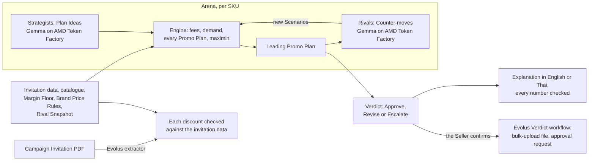

# MarginArena

**Check a marketplace Campaign Invitation before you join it.** A deterministic pricing engine costs every Promo Plan
for every invited product, AI Rivals red-team the leading plan, and each product ends in a Verdict: Approve, Revise
(including Skip) or Escalate.

Built for the AMD Developer Hackathon ACT III (Reinvent Commerce; Evolus Business Agents). Every AI call starts on
Gemma-4-31B-IT through AMD Token Factory. If Token Factory reports that Gemma has no workers, the run continues on
Qwen3.8-27B on the same route and the app names the model that answered. Every Arena run and explanation recorded in
[`evidence/`](evidence/) was answered by Gemma.

## The problem

A Thai Shopee Seller gets a Campaign Invitation inside Seller Centre: join 11.11 if you cut these products by 15–25%.
Joining is opt-in, and the Seller has to decide product by product whether it makes money.

- A Shopee Thailand Non-Mall PRIME Seller of beauty and other FMCG products pays 27.82% of the price after its own
  discounts, plus ฿1.07 per order (fees effective 4 Aug 2026).
- At those fees, a ฿100 product that costs ฿50 earns ฿21.11 at full price, ฿6.67 at 20% off, and loses ฿0.55 at 30% off.
- Nobody knows in advance how many more units a discount sells, or what lookalike competitors will do in reply.

## Try it

- **Live demo:** https://marginarena.vercel.app (the recorded run works at once; live runs and Gemma's explanations
  call AMD Token Factory).
- **On your machine:** `cp .env.example .env`, then `docker compose up --build` and open http://localhost:8008.
  - **Watch all 12 products (recorded run)** replays a real Arena recorded on AMD Token Factory. It needs no key.
  - **Run live** needs `TOKEN_FACTORY_API_KEY` in `.env`. It checks 4 of the 12 products, chosen to show every kind of
    Verdict, because Token Factory allows 20 requests a minute per account. The sample shop is the only data it sends.

## How it decides

1. **The engine computes every number** ([ADR 0001](docs/adr/0001-numbers-come-only-from-the-engine.md)):
   - marketplace fees, checked against Lazada's own worked example (it pays out ฿623.93) and a Shopee example we
     worked by hand from Shopee's published rates (it pays out ฿200.31): `backend/tests/engine/test_fees.py`;
   - demand from a price elasticity fitted on public e-commerce data, with an uncertainty band;
   - each Promo Plan's Campaign profit in every Scenario: each Counter-move at the point elasticity and at both edges
     of the band.
2. **AI explores what is open-ended; math solves what is closed** ([ADR 0004](docs/adr/0004-ai-explores-open-ended-math-solves-closed.md)):
   - Strategists (Gemma) propose Plan Ideas, such as a voucher or a gift from the catalogue;
   - the engine searches every numeric Promo Plan those ideas allow, within the invitation and the Brand Price Rules;
   - each round, Rivals (Gemma) propose Counter-moves against the leading plan, and the engine re-selects over every
     Scenario found so far.
3. **The plan with the best worst case wins** (maximin), provided it keeps the Seller's Margin Floor, earns at least
   as much as not joining, and respects every Brand Price Rule.
4. **Every Verdict explains itself**: a waterfall, the Counter-moves it was tested against, Evidence Links, and a short
   explanation in English or Thai. An explanation citing any number the engine did not produce is rejected, and
   `/api/explain` only accepts results the server signed.



## What it found on the sample shop

These are model-based estimates for a fictional shop; every figure comes from the engine.

- **Margin Protected: ฿5,434.46.** Following the 12 Verdicts of the recorded run keeps ฿5,434.46 more profit in the
  worst case than joining every product exactly as invited (the escalated product is left out:
  `evidence/runs/token-factory-sample-12sku.sse`).
- **No plan breaks a check.** Under the same Scenarios, joining as invited breaks a check on 2 products and matching
  the competitor on 3; MarginArena's plans break none ([evidence/policy-comparison.md](evidence/policy-comparison.md)).
- **An AI Rival changed a decision.** Live on Token Factory, a Rival's Counter-move turned SS-50's Approve into a Revise
  that keeps ฿3,728.85 more in the worst case
  ([evidence/red-team-token-factory.md](evidence/red-team-token-factory.md)).

## Evidence

Every number in this README comes from the engine or from these files:

| What | File |
|---|---|
| Elasticity fit and its holdout against a naive baseline | [evidence/elasticity.md](evidence/elasticity.md) |
| An AI Rival turning SS-50's Approve into a Revise, live on Token Factory | [evidence/red-team-token-factory.md](evidence/red-team-token-factory.md) |
| Thai and English explanations checked number by number | [evidence/explainer-token-factory.md](evidence/explainer-token-factory.md) |
| Four pricing policies under the same Scenarios, and Gemma's own arithmetic checked by the engine | [evidence/policy-comparison.md](evidence/policy-comparison.md) |
| The Evolus Verdict workflow carrying out confirmed Verdicts | [evidence/evolus-verdict-workflow.md](evidence/evolus-verdict-workflow.md) |
| The Evolus extractor reading the Campaign Invitation PDF | [evidence/evolus-invitation-extractor.md](evidence/evolus-invitation-extractor.md) |
| Recorded Arena runs, as streamed | [evidence/runs/](evidence/runs/) |

Why the engine and not the model computes the numbers: given the same facts and formulas, Gemma's own Campaign profit
estimates were off by a median 61.69% from the engine's, with 1 of 11 answers within 5% (`evidence/policy-comparison.md`).

## AMD

- **What runs on AMD:** every Strategist, Rival and explanation call, and the Evolus agent and extractor, run on
  Gemma-4-31B-IT through **AMD Token Factory**, AMD's hosted model API. The organisers confirmed that Token Factory
  counts as the AMD component for ACT III ([ADR 0005](docs/adr/0005-token-factory-is-the-only-inference-route.md)).
  Token Factory does not say which GPUs serve it, so we make no claim about the hardware.
- **When Gemma is unavailable:** if Token Factory answers that Gemma has no workers, the rest of the run uses
  Qwen3.8-27B on the same route. The Arena header and each explanation name the model that answered.
- **Recorded runs on Token Factory** (sample data only). Figures are the last telemetry event of each stream in
  [`evidence/runs/`](evidence/runs/):

  | Stream | Model | SKUs | Valid answers | Invalid | Failed | Retries | Tokens written | Wall time |
  |---|---|---|---|---|---|---|---|---|
  | `token-factory-sample-12sku.sse` (the replay) | Gemma-4-31B-IT | 12 | 60 | 0 | 0 | 2 | 5,153 | 248.55 s |
  | `token-factory-sample-4sku-ss50-override.sse` | Gemma-4-31B-IT | 4 | 20 | 0 | 0 | 0 | 1,646 | 78.25 s |
  | `token-factory-sample-3sku.sse` | Gemma-4-31B-IT | 3 | 15 | 0 | 0 | 1 | 1,258 | 86.41 s |
  | `token-factory-sample-3sku-maximin.sse` | Gemma-4-31B-IT | 3 | 15 | 0 | 0 | 7 | 1,259 | 118.75 s |

  Wall time mostly reflects our own pacing (15 requests a minute, under Token Factory's limit of 20 per account), not
  the model's speed. The replay plays the 12-SKU run back in about 20 seconds.
- `infra/droplet/` can serve the same model on an AMD Developer Cloud MI300X with vLLM. It is optional and was not used
  for the submission.

## Evolus

An Evolus document extractor reads the Campaign Invitation PDF (the sample's, the only document the demo sends) and the
app checks every discount it read against the invitation the Arena uses
([evidence/evolus-invitation-extractor.md](evidence/evolus-invitation-extractor.md)). When the Seller confirms,
MarginArena hands the Verdicts to an Evolus workflow, which carries them out: it sorts them,
writes the bulk-upload file, and has the Campaign Desk agent draft the shop owner's approval request for escalated
products, citing the brand agreement and fee rules from its knowledge library. The agent runs on our own model
connection (Gemma-4-31B-IT on AMD Token Factory), so the run uses no Evolus credits
([evidence/evolus-verdict-workflow.md](evidence/evolus-verdict-workflow.md)). Nothing is sent or registered.

The Arena's own calls go straight to Token Factory rather than through an Evolus agent. Each one is a short JSON
proposal that the engine scores at once, and an Evolus agent in between would add a hop and count against the
workspace's 60 requests a minute without changing any result
([ADR 0003](docs/adr/0003-arena-bypasses-evolus.md)). Evolus runs the business process around the decision: it reads
the Campaign Invitation, holds the fee rules and the brand agreement, and carries out the Verdicts once the Seller
confirms. The Evolus runs don't report whether Gemma or its Qwen fallback answered.

`infra/evolus/evolus_kit.py` builds all of it from code: `plan` only reads, and `apply` creates what is missing,
finding each resource by name first. See [infra/evolus/README.md](infra/evolus/README.md).

## Assumptions and limits

- **The sample shop is fictional.** Glow Lab BKK's costs, stock, baselines, brand agreement and Rival Snapshot are
  invented; the fees are Shopee Thailand's.
- **Elasticity comes from online grocery data** (FreshRetailNet-50K by Dingdong Ltd., CC BY 4.0, from Chinese cities;
  the repo holds only the fitted parameters), not marketplace skincare. SS-50 carries a
  labelled Seller override: the published mean elasticity, −2.62 (Bijmolt, Van Heerde and Pieters 2005), with a band of
  our own construction.
- **Joining is assumed to bring 2.5× the Campaign traffic before any price effect**, against 1× for not joining. It
  comes from Lazada reporting about 3.5× GMV in its March 2026 Birthday Campaign (a press report), divided by the
  price effect of an average 20% cut at elasticity −1.49 (×1.39). No source measures it for 11.11, it moves every
  Verdict, and the Seller can change it.
- **Two assumptions have no source:** when a Rival ends up cheaper, the Seller keeps (Rival price ÷ our price)^1.0 of
  its buyers, and each Counter-move lasts the whole Campaign, which overstates a short flash sale.
- **A gift is valued at 30% of its retail price** by buyers. This is an assumption the Seller can change.
- **Fees:** Shopee does not publish the base of its PRIME programme fee, so we assume the commission base. The rates
  are the FMCG category's, for a Seller that is not VAT-registered. Every buyer is assumed to claim the shop voucher.
- **The explanation check proves numbers, not labels.** Each shown explanation sits next to the engine's own figures.

## Failures we have seen, and the safeguards

- **Token Factory is a free shared service with no uptime promise.** On 15 Oct Gemma had no workers for a while
  (the run switches to Qwen3.8-27B and says so), and on 14 Oct the first calls hung for over two minutes. The recorded
  run is therefore the default demo, labelled as recorded.
- **The Evolus platform OCR failed** (HTTP 502), so the extractor reads a PDF's own text. A scanned invitation would
  fail until OCR works again.
- **A right number with the wrong label:** one Thai explanation said the plan was tested against 183 Promo Plans; the
  engine had searched 183 plans and tested the leader against the Counter-moves
  ([evidence/explainer-token-factory.md](evidence/explainer-token-factory.md)).
- **Safeguards:** the Seller confirms before anything happens, and nothing is registered with the marketplace or sent;
  Escalate hands a genuine trade-off to a person; every number in an explanation is checked against the engine;
  `/api/explain` and `/api/confirm` accept only results this server signed; Token Factory only ever sees the sample
  shop.

## Develop

```bash
uv run --project backend pytest backend/tests -q        # engine and API tests (the model server is faked)
uv run --project backend --env-file .env uvicorn --factory marginarena.api:create_app --port 8008
npm --prefix web install && npm --prefix web run dev    # http://localhost:5173, proxies /api to :8008
```

Record a new demo run (sample data only): `uv run --project backend --env-file .env python backend/scripts/record_arena.py`.

## Repository

| Path | What |
|---|---|
| `backend/src/marginarena/engine/` | The pricing engine: pure functions, money in Decimal |
| `backend/src/marginarena/arena.py` | The Arena: Strategists, Rivals and re-selection, streamed as Server-Sent Events |
| `backend/src/marginarena/explainer.py` | Explanations in English or Thai, with the number check |
| `web/src/` | The web app: Invitation, Arena, Verdicts, Confirm |
| `docs/adr/` | Why the design is the way it is |
| `CONTEXT.md` | The glossary every name in the code follows |

## License

MIT. See [LICENSE](LICENSE).
