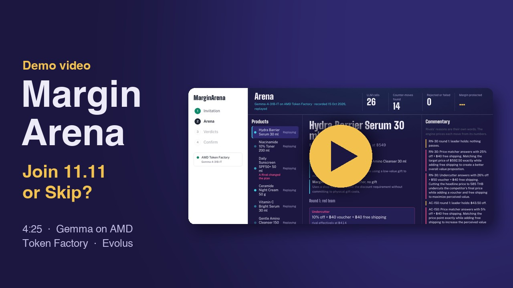
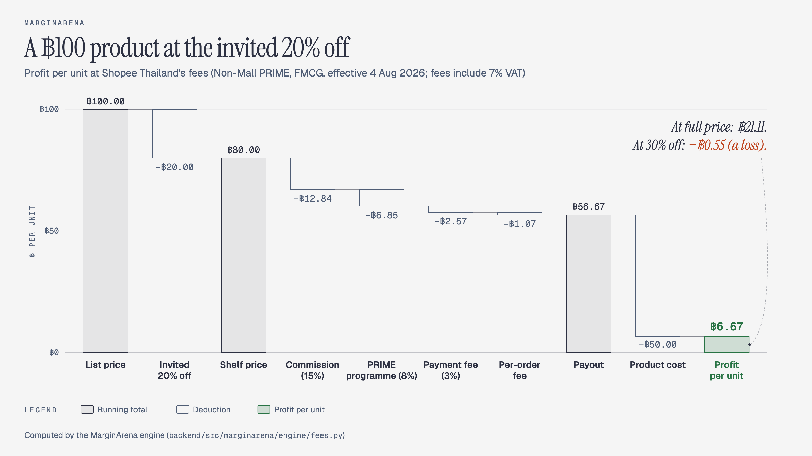
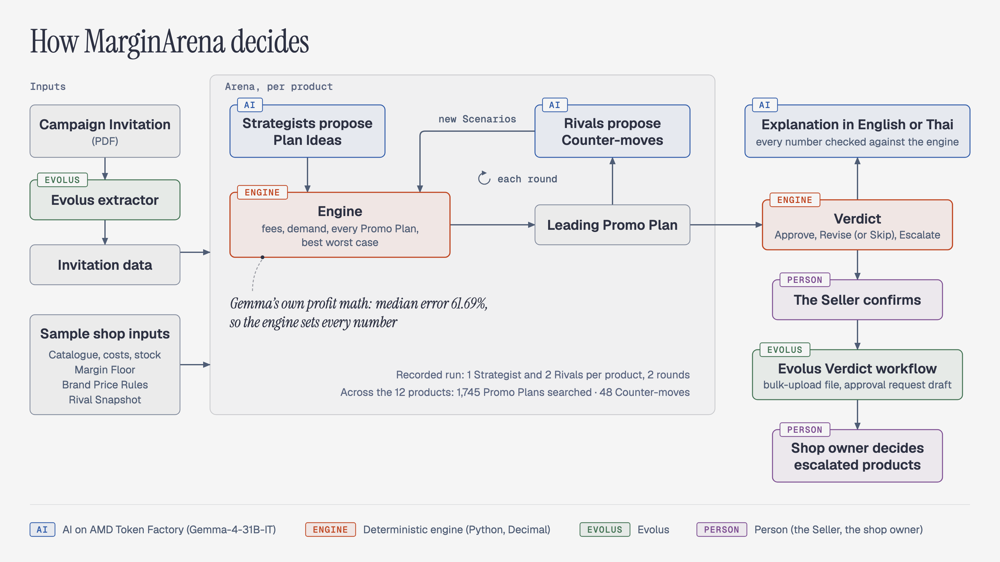

# MarginArena AI

[](https://youtu.be/dhfFiJWZxjM)

▶ [Demo video](https://youtu.be/dhfFiJWZxjM).

> **More sales don't always mean more profit.**

**Before a marketplace Campaign like 11.11, Shopee asks Sellers to discount chosen products. MarginArena checks every
invited product first, decides whether each one is worth including in the Campaign, and recommends a clear action:
join, join with a better plan, skip, or let the owner decide.**

**[Live demo](https://marginarena.vercel.app)** · [Video (4:25)](https://youtu.be/dhfFiJWZxjM) ·
[Pitch deck (PDF)](docs/pitch/MarginArena-deck.pdf) ·
[lablab submission](https://lablab.ai/ai-hackathons/amd-developer-hackathon-act-iii/infinite-curve/marginarena-the-ai-campaign-war) ·
[Results](#impact) · [Run it locally](#run-it-locally)

[](https://marginarena.vercel.app)
[](#amd)
[](#amd)
[](https://lablab.ai/ai-hackathons/amd-developer-hackathon-act-iii/infinite-curve/marginarena-the-ai-campaign-war)
[](LICENSE)

## What it does

**MarginArena helps Thai Shopee Sellers decide**, product by product, whether to join a Campaign Invitation and on what
terms.

### The question every Seller faces

Take a product listed at ฿100 that costs ฿50. At Shopee Thailand's fees for a Non-Mall PRIME Seller (27.82% of the price
plus ฿1.07 per order), it earns ฿21.11 per unit at full price, only ฿6.67 at 20% off, and loses ฿0.55 at 30% off. A
deeper discount may bring more buyers, but whether it raises total profit depends on demand, costs, fees, stock and
what competitors do.

### How MarginArena answers it

MarginArena works this out before the Seller commits:

1. **Price every plan.** A deterministic engine computes the fees, the extra demand each discount brings and the
   Campaign profit of every Promo Plan the invitation allows.
2. **Red-team it.** AI Rivals (Gemma on AMD Token Factory) play competing sellers and propose Counter-moves; every plan
   is tested against each one under a range of demand assumptions.
3. **Keep the safest plan.** The plan with the best worst case wins, provided it keeps the Seller's Margin Floor, follows
   the brand's pricing rules and earns at least as much as not joining.
4. **Give a Verdict.** Each product gets one: join as invited (Approve), join with a better plan (Revise), skip, or
   escalate to the owner, with a short explanation in Thai or English.
5. **Act only after the Seller confirms.** An Evolus workflow then prepares the upload file and the owner's approval
   request. Nothing is sent automatically.

### Who it's for

A Thai Shopee Seller of beauty and everyday goods (Non-Mall, in the PRIME programme) deciding, product by product,
whether to accept a Campaign Invitation.

It is not limited to one category: fees are data, so another category, a Mall Seller or Lazada needs only its own fee
rates and, ideally, its own demand data. The demo's rate (16.05% commission, incl. VAT) is the one 862 of Shopee
Thailand's 1,437 Non-Mall categories pay.

## Impact

On a fictional 12-product shop (engine estimates; no real Seller has used it yet). *Worst case* means the lowest
profit across every Counter-move and demand assumption tested.

| What we measured | Result |
|---|---|
| Skipping 2 of the 12 products | **฿1,648.50** more profit in the worst case (+32.8% and +34.2% on those two) |
| With a labelled demo override on one sunscreen | **฿5,434.46** more across the 11 products decided (+1.8%) |
| Plans that break a check | **0** of 11 with MarginArena; 2 joining as invited; 3 matching the competitor |
| Gemma doing the profit math itself | off by a median **61.69%**, so the engine computes every number |
| Recorded run on AMD Token Factory | **60 of 60** valid AI answers; the Evolus workflow used **0** credits |

## Try it in one minute

At https://marginarena.vercel.app (the first load can take a few seconds):

1. **Watch the recorded Arena**: a real 12-product run on AMD Token Factory, replayed in about 20 seconds. The first
   screen also shows Evolus's recorded reading of the invitation PDF.
2. See the AI Rivals answer each plan. They change Daily Sunscreen's plan twice (labelled override; a rule-based Rival
   does too).
3. **See the Verdicts**: 8 Approve (join as invited), 1 Revise (a better plan), 2 Skip, 1 Escalate (the owner
   decides). Open **How we decided**, then **ไทย** for Thai.
4. **Review and confirm**, then **Confirm and run the Evolus workflow**: it writes the upload file and drafts the
   approval request, sending nothing.

## The problem

A Campaign Invitation says: join 11.11 if you cut these products by 15–25%. A Non-Mall PRIME Seller pays 27.82% plus
฿1.07 per order ([fees](.scratch/marginarena/research/marketplace-fees.md), from 4 Aug 2026); a survey of more than 500
Thai SMEs, drawn from a complaint database, put average net profit after fees at 2.3%. Nobody knows how many extra units a discount sells, or how
competitors will reply.



## How it works



*The Arena reads the invitation from the sample shop file; Evolus's reading of the PDF is checked against it, not fed in.*

1. **Gemma proposes** ([ADR 0004](docs/adr/0004-ai-explores-open-ended-math-solves-closed.md)): a Strategist
   suggests Plan Ideas (a voucher, a gift); the engine prices every numeric Promo Plan they allow.
2. **Rivals red-team the leader** with Counter-moves, reasons in their own words; the engine re-selects over every
   Scenario (a Counter-move with a demand assumption).
3. **The engine computes every number** ([ADR 0001](docs/adr/0001-numbers-come-only-from-the-engine.md)) and picks
   the best worst case (maximin) among plans that keep the Margin Floor (unit profit of at least 10.0% of the price
   here), earn at least as much as not joining and respect every Brand Price Rule. If not joining wins in the
   worst case and on average, it is a Skip; a real trade-off goes to a person.
4. **Every Verdict explains itself** in a waterfall and a Thai or English text; one citing a number the engine did not
   produce is rejected, and only server-signed Verdicts can be explained or confirmed
   ([rules and their tests](docs/details.md#rules-the-code-enforces)).

**Demand is a formula, not a model's guess:** baseline × traffic lift (×2.5, assumed) × (buyer price ÷ list
price)^elasticity × share kept against a cheaper Rival, capped at stock
([demand.py](backend/src/marginarena/engine/demand.py)), with a fitted elasticity of −1.49 (band −1.98 to −0.77;
[fit](evidence/elasticity.md)).

**Run scale:** in the recorded run each product got 1 Strategist and 2 Rivals over 2 rounds: 48 Counter-moves, 1,745
Promo Plans searched. The code's 3 Strategist and 6 Rival personas were not used.

## Results on the sample shop

- **Where ฿5,434.46 comes from:** Margin Protected is the worst-case gain over joining as invited, counted over the 11
  products MarginArena decided (the escalated one is left out). The two Skips, RN-30 (retinal night serum) and SM-10
  (sheet mask), keep ฿1,648.50 with no override, assuming 2.5× Campaign traffic; ฿3,785.96 of it (70%) is the Revise
  of SS-50 (Daily Sunscreen), which rests on the labelled override.
- **The four checks** are the Margin Floor, every Brand Price Rule, earning at least as much as not joining, and the
  invited discount. Given the same facts and formulas, 1 of Gemma's 11 profit estimates came within 5% of the engine's.
- **Explanations:** all 32 drafts Gemma-4-31B-IT wrote for the recorded Verdicts passed the number check on the first
  draft ([explanations](evidence/explainer-replay-12sku.md)).
- **The override is a demonstration, not a finding:** we gave SS-50 elasticity −2.62 (the published mean), not our
  fit of −1.49, on purpose, to show a Counter-move changing a plan. At our fit, SS-50 is an Approve; with the override,
  its Revise is safer but earns less on average ([more](docs/details.md#what-it-found-in-full)).
- **Robust to who plays the Rival:** on the same Plan Ideas, rule-based (deepest allowed move) and random Rivals give
  the same 12 Verdicts and cut worst cases deeper than Gemma ([sensitivity](evidence/sensitivity.md)).

## Business case

Estimates; sources in [thai-seller-market.md](.scratch/marginarena/research/thai-seller-market.md).

- **Why now:** Shopee and Lazada each raised fees three times in 2026; Thailand's new Platform Fee Subcommittee
  classes joining Campaigns as an optional cost.
- **Alternatives** report profit after the sale (BigSeller, ZORT), price one unit (KhumMai, GetOneCart) or fill the
  Campaign (Shopee Easy Nomination, Lazada recommended price). None we found tests an invitation before the Seller
  accepts.
- **Planned pricing (an assumption, not validated):** Free (1 Campaign a month, up to 10 products), Pro ฿390 a month,
  Agency ฿1,990 a month, Enterprise.
- **Market (at Pro):** TAM ≈฿5.62B a year (a ceiling: all ≈1.2 million Thai MSME shops on Shopee); SAM ≈฿795.6M (the
  ≈170,000 Sellers who reached new customers in 9.9, our proxy for Campaign-active Sellers); SOM ≈฿39.8M (5% of
  those, an assumption). Both counts are Shopee's. The two Skips alone are worth about 4.2 months of Pro.
- **Go-to-market (planned, not started):** Thai Seller communities and e-commerce agencies.
- **What the AI does:** Gemma proposes Plan Ideas, gives each Counter-move a reason and explains each Verdict in Thai
  or English; Evolus reads the invitation. The arithmetic and demand stay in the engine (see Gemma's 61.69% above).

## Evolus

The app calls Evolus at run time over its REST API ([api.py](backend/src/marginarena/api.py)): three building blocks
(extractor, workflow, knowledge library) and an agent, all built from code by [`evolus_kit.py`](infra/evolus/README.md).

- **Extractor** "MarginArena Invitation Reader" (output structure "Campaign Invitation", `ask-file`) reads the
  invitation PDF: from the live site in 14.9 s, 12 of 12 minimum discounts matching; 4 of its 9 runs failed, all on
  15 Oct (2 in an Evolus OCR outage).
- **Workflow** "MarginArena Verdict" (5 steps, `execute` on **Confirm**) carries out confirmed Verdicts and writes the
  bulk-upload file: 0 Evolus credits, nothing sent or registered; 5 of 5 runs succeeded.
- **Agent** "MarginArena Campaign Desk", with the knowledge library "MarginArena Campaign Desk library", drafts the
  owner's approval request for Escalates from the engine's figures.
- **Model connection** "tf-gemma on AMD": Gemma-4-31B-IT on Token Factory with a Qwen3.8-27B fallback; Evolus does
  not record which answered ([every execution](evidence/evolus-workspace-usage.md)).

The track asks for "your own vLLM endpoint on AMD Developer Cloud"; an AMD mentor said in the event Discord that Token
Factory "perfectly satisfies this requirement", the lablab page says event workspaces run on "an open model through a
vLLM endpoint on AMD Developer Cloud, or any OpenAI-compatible provider", and the organisers said standalone GPUs "are
not needed" ([ADR 0005](docs/adr/0005-token-factory-is-the-only-inference-route.md)).

The Arena calls Token Factory directly: each call is a short JSON proposal that the engine scores at once, so an Evolus
agent in between would add a hop and use the workspace's 60 requests a minute without changing any result. Evolus runs
the business process around the decision: it reads the invitation, holds the fee rules and the brand agreement, and
carries out the Verdicts once the Seller confirms ([ADR 0003](docs/adr/0003-arena-bypasses-evolus.md);
[more](docs/details.md#evolus-in-full)).

## AMD

- **Every model call the app makes goes to AMD Token Factory,** AMD's hosted model API.
- **Gemma-4-31B-IT** plays the Strategist and the Rivals, wrote the 24 served explanations and answered every
  recorded Arena run and explanation in `evidence/` but one labelled DeepSeek-V4-Flash fallback run
  ([all 7 runs](docs/details.md#recorded-runs-on-token-factory)).

## Run it locally

No keys needed; also the fallback if the site is down:

```bash
cp .env.example .env && docker compose up --build    # then open http://localhost:8008
```

Checked from a fresh clone on 17 Oct 2026 (the recorded Arena: 138 events, no errors). Live runs need
`TOKEN_FACTORY_API_KEY` ([develop](docs/details.md#develop)).

## Assumptions and limits

- **Sample shop only, no input controls:** Glow Lab BKK is fictional, a Seller's own data can't be uploaded yet, and
  the assumed values are labelled in the sample shop file.
- **Traffic lift ×2.5 is unsourced** (our own arithmetic gives about ×3.1); at ×3.0 the two Skips become Escalates.
- **Elasticity is from online grocery data** (FreshRetailNet-50K, Dingdong Ltd., CC BY 4.0), applied to price cuts only.
- **Also unsourced:** buyers kept when undercut ((Rival price ÷ our price)^1.0), Counter-moves lasting the whole
  Campaign, a gift worth 30% of retail, the PRIME fee base, every buyer claiming the voucher.
- **The explanation check proves numbers, not labels:** a review of the first 24 recorded texts against the engine's
  figures found 5 wrong labels (fixed).
- **Token Factory has no uptime promise** (Gemma once dropped out of its catalogue), so the recorded run is the
  default demo; it sees only the sample shop.

[Full list](docs/details.md#assumptions-and-limits-in-full) · [failures and safeguards](docs/details.md#failures-we-have-seen-and-the-safeguards).

## Roadmap

A pilot with Thai Sellers before 12.12 (none is running yet); uploads of a Seller's own data and a private model
endpoint; then Lazada, TikTok Shop and the rest of Southeast Asia.

## Evidence

Every product and profit number comes from the engine or these files: [sensitivity](evidence/sensitivity.md),
[policy comparison](evidence/policy-comparison.md), [runs](evidence/runs/), [red-team](evidence/red-team-token-factory.md),
[explanations](evidence/explainer-replay-12sku.md), [Evolus](evidence/evolus-workspace-usage.md),
[elasticity](evidence/elasticity.md) ([full table](docs/details.md#evidence-in-full)).

## Repository

`backend/` (engine, Arena, API) · `web/` (the app) · `infra/evolus/` · `evidence/` · `docs/adr/` (decisions) ·
`infra/droplet/` (optional, never run) ·
[full map](docs/details.md#repository).

## License

MIT. See [LICENSE](LICENSE). Built solo from Thailand for the AMD Developer Hackathon ACT III (Reinvent Commerce;
Evolus Business Agents).
