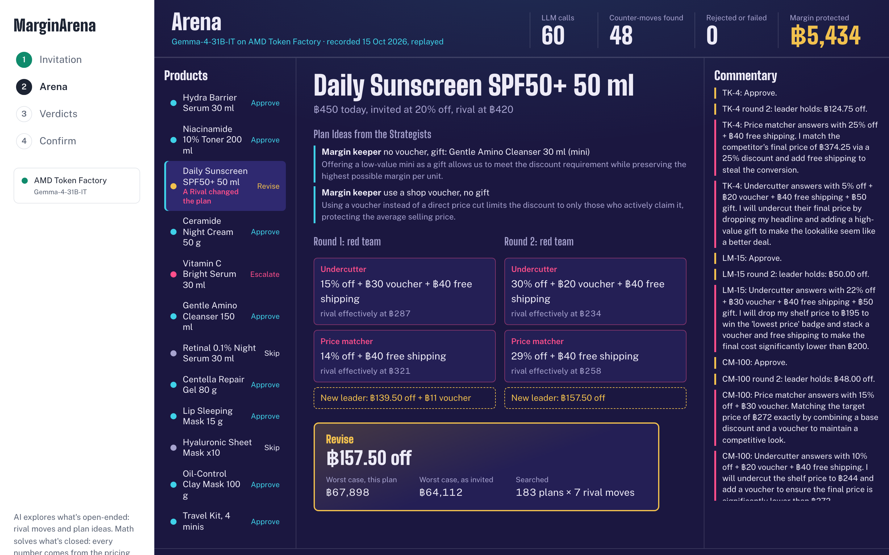
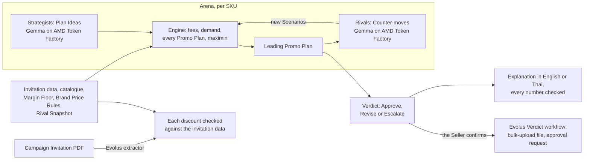

# MarginArena

**Check a marketplace Campaign Invitation before you join it.** A deterministic pricing engine costs every Promo Plan
for every invited product, AI Rivals red-team the leading plan, and each product ends in a Verdict: Approve, Revise
(including Skip) or Escalate.

Built for the AMD Developer Hackathon ACT III (Reinvent Commerce; Evolus Business Agents). Every model call MarginArena
makes goes to **AMD Token Factory**: Gemma-4-31B-IT answered every recorded Arena and explanation run except one
labelled DeepSeek-V4-Flash fallback run. The app switches to that fallback only when Token Factory does not list Gemma,
or answers that Gemma has no workers or is not served. Evolus reads the Campaign Invitation and carries out the
Verdicts.

**Try it in one minute** at **https://marginarena.vercel.app** (no key, no sign-up):

1. Press **Watch the recorded Arena**: a real 12-product run on AMD Token Factory, replayed in about 20 seconds.
2. The Arena opens on **Daily Sunscreen**, where an AI Rival's Counter-move changed the leading plan in both rounds.
3. Press **See the Verdicts**: 8 Approve, 1 Revise, 2 Skip, 1 Escalate. Open any product's **How we decided**, then
   press **ไทย** for Gemma's explanation in Thai, checked number by number against the engine. For the recorded run it
   is the explanation Gemma wrote for that exact Verdict on 17 Oct, read by a person and shown at once, labelled as
   recorded; **Ask Gemma again (live)** calls Token Factory (usually seconds, but it has hung for about 140 s).
4. Press **Review and confirm** to hand the Verdicts to the Evolus workflow.

**What it found on the sample shop:** skipping two of the 12 products keeps **฿1,648.50** more profit in the worst case
than joining them as invited (+32.8% and +34.2% on those products). With a labelled Seller override on one sunscreen,
following all 11 decided Verdicts keeps **฿5,434.46** more, and none of its plans breaks a check
([details and caveats](#what-it-found-on-the-sample-shop)).



## The problem

A Thai Shopee Seller gets a Campaign Invitation inside Seller Centre: join 11.11 if you cut these products by 15–25%.
Joining is opt-in, and the Seller has to decide product by product whether it makes money.

- A Shopee Thailand Non-Mall PRIME Seller of beauty and other FMCG products pays 27.82% of the price after its own
  discounts, plus ฿1.07 per order (fees effective 4 Aug 2026).
- At those fees, a ฿100 product that costs ฿50 earns ฿21.11 at full price, ฿6.67 at 20% off, and loses ฿0.55 at 30% off.
- Nobody knows in advance how many more units a discount sells, or what lookalike competitors will do in reply.

## Try it

- **Live demo:** https://marginarena.vercel.app (the recorded run works at once; live runs and Gemma's explanations
  call AMD Token Factory).
- **On your machine:** `cp .env.example .env`, then `docker compose up --build` and open http://localhost:8008.
  Checked from a fresh clone of this repo on 17 Oct 2026 (macOS, Docker Desktop, Docker 29.8.2, no keys): the page,
  `/api/health`, the recorded Arena (138 events, no errors), and the recorded Evolus reading and workflow run all answer.
  - **Watch the recorded Arena (about 20 s)** replays a real Arena recorded on AMD Token Factory. It needs no key.
  - **Run 4 live on AMD Token Factory** needs `TOKEN_FACTORY_API_KEY` in `.env`. It checks 4 of the 12 products, chosen to show every kind of
    Verdict, because Token Factory allows 20 requests a minute per account. The sample shop is the only data it sends.
- **Sample shop only:** the demo runs on a fictional shop. A Seller's own catalogue, invitation and Rival Snapshot can't
  be uploaded yet (on the roadmap).

## How it decides

1. **The engine computes every number** ([ADR 0001](docs/adr/0001-numbers-come-only-from-the-engine.md)):
   - marketplace fees, checked against Lazada's own worked example (it pays out ฿623.93) and a Shopee example we
     worked by hand from Shopee's published rates (it pays out ฿200.31): `backend/tests/engine/test_fees.py`;
   - demand from a price elasticity fitted on public e-commerce data, with an uncertainty band;
   - each Promo Plan's Campaign profit in every Scenario: each Counter-move at the point elasticity and at both edges
     of the band.
2. **AI explores what is open-ended; math solves what is closed** ([ADR 0004](docs/adr/0004-ai-explores-open-ended-math-solves-closed.md)):
   - Strategists (Gemma) propose Plan Ideas, such as a voucher or a gift from the catalogue;
   - the engine searches every numeric Promo Plan those ideas allow, within the invitation and the Brand Price Rules;
   - each round, Rivals (Gemma) propose Counter-moves against the leading plan, and the engine re-selects over every
     Scenario found so far.
3. **The plan with the best worst case wins** (maximin), provided it keeps the Seller's Margin Floor, earns at least
   as much as not joining, and respects every Brand Price Rule.
4. **Every Verdict explains itself**: a waterfall, the Counter-moves it was tested against, Evidence Links, and a short
   explanation in English or Thai. An explanation citing any number the engine did not produce is rejected, and
   `/api/explain` only accepts results the server signed.



## What it found on the sample shop

These are model-based estimates for a fictional shop; every figure comes from the engine.

- **Two Skips: ฿1,648.50.** Skipping RN-30 and SM-10 keeps ฿1,648.50 more profit in the worst case than joining them
  as invited. This needs no override.
- **Margin Protected with the override: ฿5,434.46.** Following the 12 Verdicts of the recorded run keeps ฿5,434.46
  more in the worst case than joining every product exactly as invited (the escalated product is left out:
  `evidence/runs/token-factory-sample-12sku.sse`). ฿3,785.96 of it (70%) comes from SS-50's Revise, which rests on a
  labelled sample Seller override (elasticity −2.62, the published mean, instead of our pooled −1.49). We added that
  override deliberately, so the sample shows a Counter-move changing a plan on a product with many lookalike
  listings: it is a demonstration, not a measured finding. At the pooled fit, SS-50 is an Approve
  ([q56-red-team.md](.scratch/marginarena/research/q56-red-team.md), [evidence/sensitivity.md](evidence/sensitivity.md)).
- **SS-50's Revise trades average profit for a safer worst case.** Maximin keeps ฿3,785.96 more in the worst case, but
  averaged over its Scenarios the plan earns ฿79,244.00 against ฿108,260.42 for joining as invited. At the point
  elasticity, joining as invited earns more against all 7 Counter-moves; the Revise does better only at the edge of
  the elasticity band, against the 3 deepest undercuts (its "How we decided" table). A Seller who prefers the
  average can join as invited (`sku_decided` for SS-50 in `evidence/runs/token-factory-sample-12sku.sse`).
- **How much rests on the assumptions** ([evidence/sensitivity.md](evidence/sensitivity.md)): Margin Protected is
  ฿12,787.08 if joining brings no extra traffic (×1.0) and ฿4,581.05 at ×3.0.
- **The Verdicts do not depend on who plays the Rival.** With a rule-based Rival that always makes the deepest move
  allowed, or with random moves inside the same bounds (both on the same Plan Ideas), the Verdicts are the same 8 Approve, 1 Revise, 2 Skip and
  1 Escalate (Margin Protected ฿4,005.56 and ฿4,113.36); with only the three generic moves, SS-50 stays an Approve
  (฿2,038.53). Gemma's part is to propose Counter-moves with a stated reason, not deeper ones: those two
  controls lower the worst cases further than Gemma's moves do (same file).
- **In percentages** (worst-case profit kept over joining as invited, from the engine's figures in
  [evidence/policy-comparison.md](evidence/policy-comparison.md)): +32.8% on RN-30 and +34.2% on SM-10 by skipping
  them, +5.9% on SS-50 (with its override), and +1.8% across the 11 products MarginArena decided.
- **No plan breaks a check.** Under the same Scenarios, joining as invited breaks a check on 2 products and matching
  the competitor on 3; MarginArena's plans break none ([evidence/policy-comparison.md](evidence/policy-comparison.md)).
- **Red-teaming changed a decision.** In the recorded 12-product run, the Rivals' Counter-moves changed SS-50's leading
  plan in both rounds (the ฿3,785.96 above); a rule-based or random Rival changes it too. It happened again in a separate live 4-product run on Token Factory,
  where the Revise keeps ฿3,728.85 more in the worst case
  ([evidence/red-team-token-factory.md](evidence/red-team-token-factory.md)). Both rest on the SS-50 override.

## Business case

All market figures are estimates or assumptions, with the arithmetic shown; sources are in
[`.scratch/marginarena/research/thai-seller-market.md`](.scratch/marginarena/research/thai-seller-market.md).

- **Who it is for:** a small Thai Shopee Seller who receives Campaign Invitations in Seller Centre and decides product
  by product whether to join. About 1.2 million Thai MSME shops are on Shopee, and about 170,000 Sellers reached new
  customers in the 9.9 (2026) Campaign (both are Shopee's own figures). A survey of more than 500 Thai SMEs, drawn from
  a complaint database, put average net profit after fees at 2.3%.
- **Why now:** Shopee and Lazada each raised their fees three times in 2026
  ([marketplace-fees.md](.scratch/marginarena/research/marketplace-fees.md)), so every Campaign discount eats into a
  thinner margin.
- **Planned pricing (an assumption, not validated):** Free (1 Campaign a month, up to 10 products), Pro ฿390 a month,
  Agency ฿1,990 a month (several shops, the Evolus workflow), and Enterprise for Mall stores and brands.
- **Market in Thailand (estimates):** if every one of the 1.2M shops paid Pro, ≈฿5.62B a year (a ceiling, since it
  counts shops); for the about 170,000 Thai Sellers that Shopee says reached new customers in 9.9 (our proxy for Campaign-active
  Sellers), ≈฿795.6M a year; at 5% of them (an assumption), ≈฿39.8M a
  year.
- **What it is worth to one Seller (estimate):** on the sample shop, the two Skips alone keep ฿1,648.50 more in the
  worst case ([evidence/sensitivity.md](evidence/sensitivity.md)), about 4.2 months of Pro.
- **Why it needs AI, and why AI alone is not enough:** the AI does the language work (reading the Campaign Invitation,
  proposing Plan Ideas and Counter-moves with a reason, explaining each Verdict in Thai or English, drafting the owner's
  approval request); Gemma's own profit arithmetic was off by a median 61.69%
  ([evidence/policy-comparison.md](evidence/policy-comparison.md)), so the engine computes every number.

## Roadmap

1. A pilot with Thai Sellers before 12.12 (we are looking for Sellers; none is running yet), so elasticity, traffic
   lift and rival behaviour are measured on real sales.
2. Rival Snapshot capture: read lookalike competitor listings from screenshots.
3. A private model endpoint, so real Seller costs never go to a shared API.
4. More Marketplace Profiles: Lazada (the LazMall fees already match Lazada's worked example), then TikTok Shop.
5. Mall stores and brands, then other Southeast Asian markets with the same Campaign mechanics.

Built solo from Thailand for the AMD Developer Hackathon ACT III.

## Evidence

Every product and profit number in this README comes from the engine or from these files; the fee and market figures
come from the last two, with their sources:

| What | File |
|---|---|
| Elasticity fit and its holdout against a naive baseline | [evidence/elasticity.md](evidence/elasticity.md) |
| Red-teaming turning SS-50's Approve into a Revise, live on Token Factory (with the labelled override) | [evidence/red-team-token-factory.md](evidence/red-team-token-factory.md) |
| Thai and English explanations checked number by number | [evidence/explainer-token-factory.md](evidence/explainer-token-factory.md) |
| Gemma's explanations of the 12 replayed Verdicts, and the hand review that caught 5 wrong labels | [evidence/explainer-replay-12sku.md](evidence/explainer-replay-12sku.md) |
| Four pricing policies under the same Scenarios, and Gemma's own arithmetic checked by the engine | [evidence/policy-comparison.md](evidence/policy-comparison.md) |
| The Evolus Verdict workflow carrying out confirmed Verdicts | [evidence/evolus-verdict-workflow.md](evidence/evolus-verdict-workflow.md) |
| The Evolus extractor reading the Campaign Invitation PDF | [evidence/evolus-invitation-extractor.md](evidence/evolus-invitation-extractor.md) |
| Every Evolus execution in the workspace, and two live runs from the live site on 17 Oct | [evidence/evolus-workspace-usage.md](evidence/evolus-workspace-usage.md) |
| How the Verdicts move with traffic lift, the SS-50 override and the AI Rivals | [evidence/sensitivity.md](evidence/sensitivity.md) |
| Recorded Arena runs, as streamed | [evidence/runs/](evidence/runs/) |
| Shopee and Lazada fees (sourced research) | [.scratch/marginarena/research/marketplace-fees.md](.scratch/marginarena/research/marketplace-fees.md) |
| Thai Seller market estimates (sourced research) | [.scratch/marginarena/research/thai-seller-market.md](.scratch/marginarena/research/thai-seller-market.md) |

Why the engine and not the model computes the numbers: given the same facts and formulas, Gemma's own Campaign profit
estimates were off by a median 61.69% from the engine's, with 1 of 11 answers within 5% (`evidence/policy-comparison.md`).

## AMD

- **What runs on AMD:** every Strategist, Rival and explanation call goes to Gemma-4-31B-IT through **AMD Token
  Factory**, AMD's hosted model API, and the Evolus agent and extractor use the same Token Factory connection
  (Gemma-4-31B-IT with a Qwen3.8-27B fallback; Evolus does not record which one answered). The organisers confirmed
  that Token Factory counts as the AMD component for ACT III ([ADR 0005](docs/adr/0005-token-factory-is-the-only-inference-route.md)).
  Token Factory does not say which GPUs serve it, so we make no claim about the hardware.
- **Which model answered:** every Arena run and explanation recorded in [`evidence/`](evidence/) was answered by
  Gemma-4-31B-IT, except the labelled fallback run `evidence/runs/token-factory-sample-4sku-deepseek-fallback.sse`.
- **Scale on Token Factory:** each product gets 1 Strategist and 2 Rivals over 2 rounds, because the account allows 20
  requests a minute.
- **When Gemma is unavailable:** the app reads Token Factory's model catalogue before a run and starts on
  DeepSeek-V4-Flash when Gemma is not listed; if a call answers that Gemma has no workers or is not served, the rest
  of the run switches. The sidebar, the Arena header and each explanation name the model that answered. On 15 Oct at
  about 23:00 ICT the catalogue no longer listed Gemma-4-31B-IT, and a live 4-SKU run on DeepSeek-V4-Flash answered
  20 of 20 calls in 95.9 s (`evidence/runs/token-factory-sample-4sku-deepseek-fallback.sse`).
- **Recorded runs on Token Factory** (sample data only). Figures are the last telemetry event of each stream in
  [`evidence/runs/`](evidence/runs/):

  | Stream | Model | SKUs | Valid answers | Invalid | Failed | Retries | Tokens written | Wall time |
  |---|---|---|---|---|---|---|---|---|
  | `token-factory-sample-12sku.sse` (the replay) | Gemma-4-31B-IT | 12 | 60 | 0 | 0 | 2 | 5,153 | 248.55 s |
  | `token-factory-sample-4sku-ss50-override.sse` | Gemma-4-31B-IT | 4 | 20 | 0 | 0 | 0 | 1,646 | 78.25 s |
  | `token-factory-sample-3sku.sse` | Gemma-4-31B-IT | 3 | 15 | 0 | 0 | 1 | 1,258 | 86.41 s |
  | `token-factory-sample-3sku-maximin.sse` | Gemma-4-31B-IT | 3 | 15 | 0 | 0 | 7 | 1,259 | 118.75 s |
  | `token-factory-live-site-4sku.sse` (the live site, 17 Oct) | Gemma-4-31B-IT | 4 | 20 | 0 | 0 | 0 | 1,860 | 79.84 s |
  | `token-factory-live-site-sin1-4sku.sse` (the live site from Singapore, 17 Oct) | Gemma-4-31B-IT | 4 | 20 | 0 | 0 | 0 | 1,748 | 102.5 s |
  | `token-factory-sample-4sku-deepseek-fallback.sse` (fallback, 15 Oct) | DeepSeek-V4-Flash | 4 | 20 | 0 | 0 | 0 | 2,081 | 95.9 s |

  The two 3-SKU streams were recorded on 14 Oct with earlier engine versions, so their Verdicts and Margin Protected
  differ from the replay.

  Wall time mostly reflects our own pacing (15 requests a minute, under Token Factory's limit of 20 per account), not
  the model's speed. The replay plays the 12-SKU run back in about 20 seconds.
- `infra/droplet/` can serve the same model on an AMD Developer Cloud MI300X with vLLM. It is optional and was not used
  for the submission.

## Evolus

**Model route.** The Evolus track asks for the main agent on an open model served on AMD infrastructure. Our Campaign
Desk agent and extractor use our AMD Token Factory connection through Evolus "Your models" (Gemma-4-31B-IT, with a
Qwen3.8-27B fallback; Evolus does not record which one answered). When another team asked
in the event Discord whether Token Factory meets the track's own-vLLM-endpoint rule, an AMD mentor answered (14 Oct
2026) that it "perfectly satisfies this requirement"; the lablab page also says event workspaces run on "an open model
through a vLLM endpoint on AMD Developer Cloud, or any OpenAI-compatible provider"
([ADR 0005](docs/adr/0005-token-factory-is-the-only-inference-route.md)).

**In Evolus's own terms:** people stay in the loop when they are needed (Escalate goes to the shop owner, and nothing
happens until the Seller confirms); every run leaves a trail (the workflow's execution record shows each step's output);
and the exact sums come from code, not AI (the engine computes every number the workflow carries).

An Evolus document extractor reads the Campaign Invitation PDF (the sample's, the only document the demo sends) and the
app checks every discount it read against the invitation the Arena uses
([evidence/evolus-invitation-extractor.md](evidence/evolus-invitation-extractor.md)). When the Seller confirms,
MarginArena hands the Verdicts to an Evolus workflow, which carries them out: it sorts them,
writes the bulk-upload file, and has the Campaign Desk agent draft the shop owner's approval request for escalated
products, using the engine's figures; the knowledge library with the fee rules and the brand agreement is attached
to the agent. The agent runs on our own model
connection to AMD Token Factory (Gemma-4-31B-IT, with a Qwen3.8-27B fallback; Evolus does not record which answered),
so the run uses no Evolus credits
([evidence/evolus-verdict-workflow.md](evidence/evolus-verdict-workflow.md)). Nothing is sent or registered.

The Arena's own calls go straight to Token Factory rather than through an Evolus agent. Each one is a short JSON
proposal that the engine scores at once, and an Evolus agent in between would add a hop and count against the
workspace's 60 requests a minute without changing any result
([ADR 0003](docs/adr/0003-arena-bypasses-evolus.md)). Evolus runs the business process around the decision: it reads
the Campaign Invitation, holds the fee rules and the brand agreement, and carries out the Verdicts once the Seller
confirms. The Evolus runs don't report whether Gemma or its Qwen fallback answered.

`infra/evolus/evolus_kit.py` builds all of it from code: `plan` only reads, and `apply` creates what is missing,
finding each resource by name first. See [infra/evolus/README.md](infra/evolus/README.md).

**What an Evolus reviewer will find in our workspace:** the workflow "MarginArena Verdict" (5 steps); the agent
"MarginArena Campaign Desk" with the knowledge library "MarginArena Campaign Desk library" (the 2 documents in
`infra/evolus/library/`); the extractor agent "MarginArena Invitation Reader" with the output structure "Campaign
Invitation"; and the model connection "tf-gemma on AMD" under Your models. Every execution so far is listed in
[evidence/evolus-workspace-usage.md](evidence/evolus-workspace-usage.md).

## Assumptions and limits

- **The sample shop is fictional.** Glow Lab BKK's costs, stock, baselines, brand agreement and Rival Snapshot are
  invented; the fees are Shopee Thailand's.
- **Elasticity comes from online grocery data** ([FreshRetailNet-50K](https://huggingface.co/datasets/Dingdong-Inc/FreshRetailNet-50K) by Dingdong Ltd., [CC BY 4.0](https://creativecommons.org/licenses/by/4.0/), from Chinese cities; we fitted (modified) parameters from it;
  the repo holds only the fitted parameters), not marketplace skincare. SS-50 carries a
  labelled Seller override: the published mean elasticity, −2.62 (Bijmolt, Van Heerde and Pieters 2005), with a band of
  our own construction.
- **Joining is assumed to bring 2.5× the Campaign traffic before any price effect**, against 1× for not joining. The
  starting point is Lazada reporting about 3.5× GMV in its March 2026 Birthday Campaign (a press report). Our first
  derivation divided that only by the unit effect of an average 20% cut at elasticity −1.49 (×1.39). GMV is units
  times price, so taking out the 20% lower price as well (×0.8) gives about ×3.1 (our arithmetic). We kept ×2.5, which
  makes not joining look better: at ×3.0, Margin Protected is ฿4,581.05 and the two Skips become Escalates
  ([evidence/sensitivity.md](evidence/sensitivity.md)). No source measures the lift for 11.11, it moves every Verdict,
  and it is a labelled value in the sample shop file.
- **Two assumptions have no source:** when a Rival ends up cheaper, the Seller keeps (Rival price ÷ our price)^1.0 of
  its buyers, and each Counter-move lasts the whole Campaign, which overstates a short flash sale.
- **A gift is valued at 30% of its retail price** by buyers. This is an assumption, a labelled value in the sample shop
  file.
- **Fees:** Shopee does not publish the base of its PRIME programme fee, so we assume the commission base. The rates
  are the FMCG category's, for a Seller that is not VAT-registered. Every buyer is assumed to claim the shop voucher.
- **The explanation check proves numbers, not labels.** Each shown explanation sits next to the engine's own figures.

## Failures we have seen, and the safeguards

- **Token Factory is a free shared service with no uptime promise.** On 15 Oct Gemma had no workers for a while
  (the run switched to a fallback model and said so); from that night until about 20:48 ICT on 16 Oct its catalogue
  did not list Gemma at all (the app now falls back to DeepSeek-V4-Flash); and on 14 Oct the first calls hung for over
  two minutes. The recorded
  run is therefore the default demo, labelled as recorded.
- **On 17 Oct, Token Factory's chat calls hung from Vercel's Hong Kong region** (about 140 s, then the numbers-only
  explanation), while the same calls from Thailand answered in seconds. Moving the API to Singapore fixed it: a live
  4-product run then answered 20 of 20 calls with Gemma (`evidence/runs/token-factory-live-site-sin1-4sku.sse`).
- **The Evolus platform OCR failed** (HTTP 502), so the extractor reads a PDF's own text. A scanned invitation would
  fail until OCR works again.
- **A right number with the wrong label:** one Thai explanation said the plan was tested against 183 Promo Plans; the
  engine had searched 183 plans and tested the leader against the Counter-moves
  ([evidence/explainer-token-factory.md](evidence/explainer-token-factory.md)).
- **Safeguards:** the Seller confirms before anything happens, and nothing is registered with the marketplace or sent;
  Escalate hands a genuine trade-off to a person; every number in an explanation is checked against the engine;
  `/api/explain` and `/api/confirm` accept only results this server signed; Token Factory only ever sees the sample
  shop.

## Develop

```bash
uv run --project backend pytest backend/tests -q        # engine and API tests (the model server is faked)
uv run --project backend --env-file .env uvicorn --factory marginarena.api:create_app --port 8008
npm --prefix web install && npm --prefix web run dev    # http://localhost:5173, proxies /api to :8008
```

Record a new demo run (sample data only): `uv run --project backend --env-file .env python backend/scripts/record_arena.py`.

## Repository

| Path | What |
|---|---|
| `backend/src/marginarena/engine/` | The pricing engine: pure functions, money in Decimal |
| `backend/src/marginarena/arena.py` | The Arena: Strategists, Rivals and re-selection, streamed as Server-Sent Events |
| `backend/src/marginarena/explainer.py` | Explanations in English or Thai, with the number check |
| `web/src/` | The web app: Invitation, Arena, Verdicts, Confirm |
| `docs/adr/` | Why the design is the way it is |
| `CONTEXT.md` | The glossary every name in the code follows |

## License

MIT. See [LICENSE](LICENSE).
